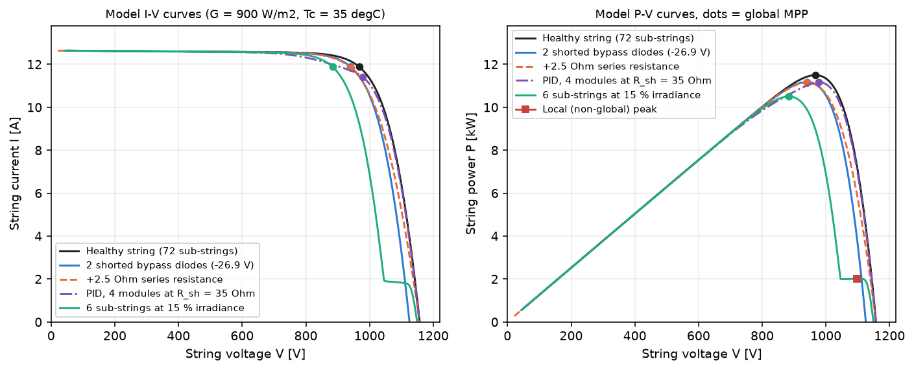
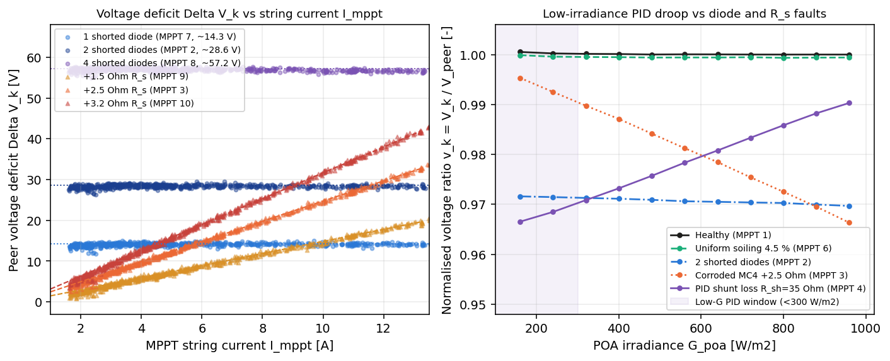
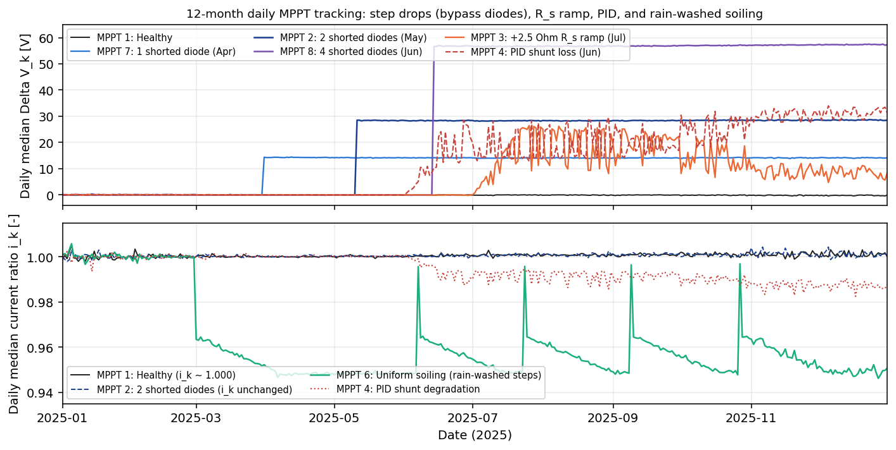
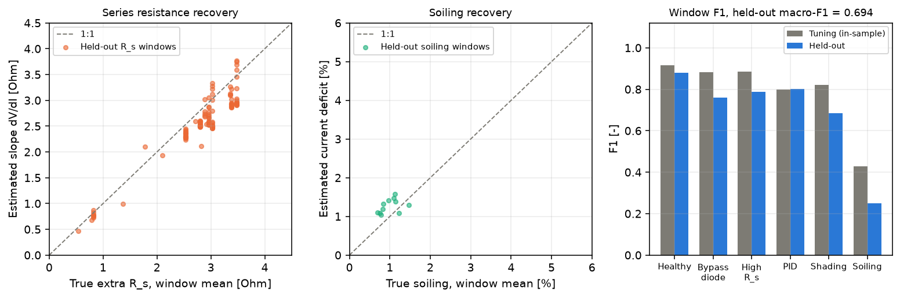

# PV string fault diagnosis from inverter MPPT voltage and current

[](https://github.com/kwwaleszczynski-del/pv-string-iv-faults/actions/workflows/ci.yml)

When a PV string loses a few percent of its power, the monthly energy waterfall in
[pv-budget-bridge](https://github.com/kwwaleszczynski-del/pv-budget-bridge) puts that deficit into the unexplained bar,
and an availability monitor such as [pv-outage-classifier](https://github.com/kwwaleszczynski-del/pv-outage-classifier)
sees the MPPT channel still running. String inverters already log the 15-minute operating voltage
$`V_k(t)`$ and current $`I_k(t)`$ of every MPPT input. This repository asks how far those two numbers, plus measured
plane-of-array irradiance $`G_{\text{poa}}`$ and the site coordinates, can separate five string faults:

- **shorted bypass diodes**: a shorted diode takes one of the 72 series sub-strings out of the string, so the string
  keeps its current and loses $`n_{\text{bd}}/72`$ of its voltage and power at every irradiance;
- **extra series resistance** $`\Delta R_s`$ (corroded MC4 connector, cracked solder joint): an ohmic drop that grows
  with current, so it vanishes at dawn and peaks at midday;
- **potential-induced degradation (PID, low shunt resistance)** on the negative-end modules: a power deficit that is
  largest at low irradiance;
- **obstacle shading**: a deficit tied to a solar azimuth and elevation sector, present only when the beam is
  blocked;
- **soiling**: an irradiance-independent current deficit that partly washes off with rain.

**All data here are synthetic.** A sub-string single-diode model generates the telemetry with faults of known size, and
a separate estimator that sees only the telemetry has to find them. Detector thresholds are fitted on one set of
synthetic inverters and every score is reported on another, held-out set.

**Interactive page:** https://kwwaleszczynski-del.github.io/pv-string-iv-faults/

> Working material, not a validated field tool. A SCADA signature can point a field crew to the MPPT input and suggest
> whether to bring connectors, a thermal camera, an electroluminescence (EL) rig or a cleaning crew. Confirm every fault
> with an I-V curve tracer, imaging and an insulation test before working on energized DC strings.

## Results

Generated by `python -m pv_iv_faults` (`results/summary.md`, quoted verbatim; a test fails if the two drift apart).
Scores are per 14-day channel window. "No decision" means the window had too few quarter-hours above
450 W/m² (mostly November to January) and counts as a miss.

<!-- generated by python -m pv_iv_faults: results/summary.md -->

| Class | Held-out windows | Precision | Recall | F1 | Tuning F1 (in-sample) |
|---|---:|---:|---:|---:|---:|
| Healthy | 1491 | 0.968 | 0.805 | 0.879 | 0.915 |
| Shorted Bypass Diode | 207 | 0.855 | 0.686 | 0.761 | 0.881 |
| High Series Resistance R_s | 140 | 0.732 | 0.857 | 0.789 | 0.886 |
| PID / Low R_sh | 215 | 0.870 | 0.744 | 0.802 | 0.798 |
| Partial Shading | 58 | 0.568 | 0.862 | 0.685 | 0.820 |
| Uniform Soiling | 62 | 0.423 | 0.177 | 0.250 | 0.427 |
| **Macro-F1** | 2173 | | | **0.694** | 0.788 |

Held-out: 8 inverters x 12 channels x 26 windows; 86.0 % of scored windows had enough irradiance for a decision; 7.0 % of decided healthy windows raised a fault alarm. In operation, an inverter with all 12 channels healthy would get 0.72 false alarms per 14-day window, about 19 a year; they came from 25 of the 86 healthy channels. Excluded from scoring: 46 onset windows and 277 windows whose fault cost less than 0.5 % of the window's energy (99 of them were still flagged).

| Parameter (held-out, correctly classified windows) | Windows | Result |
|---|---:|---|
| Shorted bypass diode count $`\hat{n}_{\text{bd}}`$ | 142 | 97.9 % exact |
| Series resistance $`\widehat{\Delta R_s}`$ relative error | 120 | median -10.1 %, 10-90 % range -16.6 % to 0.3 % |
| Soiling current loss, estimate minus truth | 11 | median 0.37 pp, median absolute 0.37 pp |

| Fault family (held-out) | Faulted channels | Detected | Median days from onset to first correct window |
|---|---:|---:|---:|
| Shorted Bypass Diode | 17 | 16 | 17 |
| High Series Resistance R_s | 9 | 9 | 21 |
| PID / Low R_sh | 15 | 15 | 33 |
| Partial Shading | 10 | 10 | 48 |
| Uniform Soiling | 5 | 2 | 26 |

| Detector (rule order) | Feature | Threshold (99th percentile of healthy tuning windows) |
|---|---|---:|
| Partial Shading | `shade_score` | 1.11 % |
| PID / Low R_sh | `pid_droop` | 0.45 % |
| High Series Resistance R_s | `dv_slope_ohm` | 0.366 Ohm |
| Shorted Bypass Diode | `v_def_hi` | 0.75 % |
| Uniform Soiling | `i_def_hi` | 1.00 % |

Showcase inverter, diagnosed on days 213-273 (1 Aug - 30 Sep):

| Channel | Injected fault | Diagnosed | True $`n_{\text{bd}}`$ | Est. $`\hat{n}_{\text{bd}}`$ | True $`\Delta R_s`$ [Ohm] | Est. $`\widehat{\Delta R_s}`$ [Ohm] | True soiling [%] | Est. soiling [%] | Low-G power deficit [%] | Annual energy [MWh] | True loss [MWh] | Est. loss [MWh] |
|---|---|---|---:|---:|---:|---:|---:|---:|---:|---:|---:|---:|
| MPPT 1: Healthy | Healthy | Healthy | 0 | 0 | 0.00 | 0.00 | 0.00 | 0.00 | 0.23 | 21.49 | 0.000 | 0.045 |
| MPPT 2: 2 shorted bypass diodes (12 May) | Shorted Bypass Diode | PID / Low R_sh | 2 | 0 | 0.00 | 0.00 | 0.00 | 0.00 | 3.46 | 21.02 | 0.409 | 0.509 |
| MPPT 3: Corroded MC4, +2.5 Ohm over 21 days (1 Jul) | High Series Resistance R_s | High Series Resistance R_s | 0 | 0 | 2.50 | 2.08 | 0.00 | 0.00 | 0.16 | 21.45 | 0.198 | 0.084 |
| MPPT 4: PID on 4 modules, R_sh 400 -> 35 Ohm (1 Jun) | PID / Low R_sh | Partial Shading | 0 | 0 | 0.00 | 0.00 | 0.00 | 0.00 | 13.68 | 20.78 | 0.536 | 0.747 |
| MPPT 5: Morning obstacle shading 6 sub-strings | Partial Shading | Partial Shading | 0 | 0 | 0.00 | 0.00 | 0.00 | 0.00 | 0.31 | 21.39 | 0.109 | 0.138 |
| MPPT 6: Soiling 0.08 %/day, rain-washed (1 Mar) | Uniform Soiling | Shorted Bypass Diode | 0 | 1 | 0.00 | 0.00 | 0.60 | 0.00 | 1.61 | 21.21 | 0.105 | 0.319 |
| MPPT 7: 1 shorted bypass diode (1 Apr) | Shorted Bypass Diode | Shorted Bypass Diode | 1 | 1 | 0.00 | 0.00 | 0.00 | 0.00 | 1.69 | 21.22 | 0.253 | 0.316 |
| MPPT 8: 4 shorted bypass diodes (15 Jun) | Shorted Bypass Diode | PID / Low R_sh | 4 | 0 | 0.00 | 0.00 | 0.00 | 0.00 | 6.17 | 20.82 | 0.635 | 0.713 |
| MPPT 9: Solder joint +1.5 Ohm (15 Apr) | High Series Resistance R_s | High Series Resistance R_s | 0 | 0 | 1.50 | 1.46 | 0.00 | 0.00 | -0.08 | 21.38 | 0.243 | 0.147 |
| MPPT 10: Corroded MC4 +3.2 Ohm (30 Apr) | High Series Resistance R_s | High Series Resistance R_s | 0 | 0 | 3.20 | 2.66 | 0.00 | 0.00 | 0.61 | 21.12 | 0.476 | 0.411 |
| MPPT 11: Healthy | Healthy | Healthy | 0 | 0 | 0.00 | 0.00 | 0.00 | 0.00 | -0.30 | 21.59 | 0.000 | -0.060 |
| MPPT 12: Healthy | Healthy | Healthy | 0 | 0 | 0.00 | 0.00 | 0.00 | 0.00 | 0.04 | 21.53 | 0.000 | 0.001 |

Showcase, all 26 windows of the year: macro-F1 0.677, 87.2 % decided, PID first flagged 16 days after onset.

Reading the numbers:

- **Shorted diodes** are counted almost always correctly once found, because the voltage ratio $`1 - V_k/V_{\text{peer}}`$
  sits at multiples of 1/72. The misses are mostly windows called "high series resistance" and winter abstentions.
- **Series resistance** is under-estimated by about a tenth. That is physics, not noise: with extra resistance the
  inverter finds its maximum power point at a slightly lower current, where the cells' own voltage is higher, so the
  voltage deficit grows more slowly than $`\Delta R_s \cdot I`$. The estimator reports the raw slope and does not
  correct it with the generating model.
- **Soiling** is the weak class. A 1 % current loss is only two to three times the string-to-string current mismatch
  of the synthetic strings (0.4 % standard deviation), and frequent rain keeps most synthetic soiling near that level.
- **The showcase inverter** (hand-written, 9 of 12 channels faulted, kept from the earlier version of this repository)
  is a hard case for a peer reference. Two diode channels are called PID because the set of channels forming the peer
  reference changes between low and high irradiance, which adds a small low-irradiance deficit; the PID channel's
  deficit depends on cell temperature, which the shading detector reads as a morning/evening pattern. These misses are
  left in the table on purpose.









## How the evaluation is set up

| Part | What it does | Sees ground truth? |
|---|---|---|
| `model.py` | Sub-string single-diode model with reverse-bias term and bypass diodes; global MPP of a faulted string | - |
| `simulator.py` | Generator: weather, fault scenarios, string mismatch, sensor noise; returns telemetry and truth separately | writes it |
| `diagnostics.py` | Estimator: peer reference, window features, thresholds, rules, parameter estimates; does not import the simulator | no |
| `evaluation.py` | Window labels, scores, detection delays | yes |
| `pipeline.py` | Tuning split, held-out split, showcase, figures, `docs/data.js` | joins both |

**Generator.** Each synthetic inverter has 12 single-string MPPT inputs of 24 x 550 Wp half-cut modules
(72 sub-strings, $`V_{\text{mp,STC}} = 1003.2\text{ V}`$, $`I_{\text{mp,STC}} = 13.16\text{ A}`$). Weather is
synthetic: clear-sky irradiance on the tilted plane, random clear and cloudy days with a seasonal probability, a
beam/diffuse split in which the beam disappears under heavy cloud, ambient temperature and daily rain. Each string gets
a photocurrent scale ($`\sigma = 0.4\,\%`$), a voltage scale ($`\sigma = 0.3\,\%`$) and a cable resistance of
0.2-0.6 Ohm. Every 15-minute operating point is the global maximum of the faulted string's model curve; the telemetry
adds 0.8 V and 0.3 % + 0.015 A noise, a pyranometer with a per-inverter calibration error (1.5 %) and 1 % noise, and
0.3 K thermometer noise. Faults are physical parameters that evolve in time:

| Fault | Physical change in the model | Random range (tuning and held-out inverters) |
|---|---|---|
| Shorted bypass diode | $`n_{\text{bd}}`$ sub-strings shorted (0 V) from the onset day | 1-4 diodes, onset day 30-300 |
| Series resistance | extra $`\Delta R_s`$ in series, step or linear ramp | 0.8-4.0 Ohm, ramp 0 or 7-45 days, onset 30-300 |
| PID | module shunt resistance decays from 400 Ohm towards a final value | 2-6 modules, 20-90 Ohm, time constant 10-60 days, onset 30-250 |
| Obstacle shading | shaded sub-strings receive 0.9 x diffuse irradiance while the sun is behind the obstacle | 3-9 sub-strings, morning or evening sector 25-50 deg wide, top 12-30 deg |
| Soiling | irradiance transmission loss, linear build-up, rain of 2 mm or more washes part of it off | 0.04-0.2 %/day, cap 3-10 %, 30-90 % washed per rain |

A channel is healthy with probability 0.4, otherwise one family is drawn uniformly. Site latitude, longitude, tilt and
azimuth are drawn per inverter as well.

**Labels.** A window is labelled with the injected fault only if the fault was active on every day of the window and
cost at least 0.5 % of the string's energy in that window (computed against the same string without the fault).
Windows containing the onset ("Transition") and windows with a smaller loss ("Below impact", for example shading in
winter when the sun never passes behind the obstacle, or soiling just after rain) are reported but not scored.

**Split.** Thresholds use only the fault-free windows of tuning inverters 1001-1008. The feature design was iterated
on those inverters only. Held-out inverters 2001-2008 and the showcase (seed 42) were run once with the frozen
estimator.

## Method

### 1. Sub-string model (Bishop 1988)

Each of the 72 sub-strings (24 cells and one bypass diode) follows the single-diode equation with Bishop's avalanche
term on the shunt current, written in the junction voltage $`V_{d}`$, plus the current of its bypass diode:

```math
I(V_{d}) = I_{\text{ph}}(G, T_c) - I_0(T_c)\left[\exp\left(\frac{V_{d}}{a(T_c)}\right) - 1\right] - \frac{V_{d}}{R_{\text{sh}}}\left[1 + a_{\text{bd}}\left(1 - \frac{V_{d}}{V_{\text{br}}}\right)^{-m_{\text{bd}}}\right] + I_{\text{bp}}(V_{\text{sub}}), \qquad V_{\text{sub}} = V_{d} - I_{\text{cell}} R_{s,\text{sub}}
```

All sub-strings carry the string current. For a given current the generator solves each group of identical
sub-strings (healthy, PID-affected, shaded) for its voltage and sums them; shorted sub-strings contribute 0 V:

```math
V_{\text{string}}(I) = s_V \sum_{g} n_g \, V_{\text{sub},g}(I) - I \left(R_{\text{cable}} + \Delta R_s\right)
```

The MPP is bracketed on a coarse current grid (so the global, not a local, maximum is kept) and then located by
golden-section search on the exact curve.

### 2. Peer reference

At every quarter-hour the channels are ranked by power and the upper half is kept. Every modelled fault lowers power,
while some raise voltage or current on their own (a PID-affected string can sit at a higher voltage and lower
current), so ranking by power keeps degraded channels out of the reference as long as fewer than half of them lose
power at the same time:

```math
V_{\text{peer}}(t) = \mathrm{median}_{k \in \mathcal{T}(t)} V_k(t), \quad I_{\text{peer}}(t) = \mathrm{median}_{k \in \mathcal{T}(t)} I_k(t), \quad P_{\text{peer}}(t) = \mathrm{median}_{k \in \mathcal{T}(t)} P_k(t)
```

where $`\mathcal{T}(t)`$ is the upper half of channels by $`P_k(t) = V_k(t) I_k(t)`$.

### 3. Window features (14 days)

With $`v_k = 1 - V_k/V_{\text{peer}}`$, $`i_k = 1 - I_k/I_{\text{peer}}`$ and $`p_k = 1 - P_k/P_{\text{peer}}`$:

| Feature | Definition |
|---|---|
| `dv_slope_ohm` | slope of $`V_{\text{peer}} - V_k`$ on $`I_k`$ for $`G > 250\text{ W/m}^2`$, least squares refitted once without residuals beyond 4 scaled MADs |
| `v_def_hi`, `i_def_hi` | medians of $`v_k`$ and $`i_k`$ for $`G \ge 450\text{ W/m}^2`$ |
| `pid_droop` | median $`p_k`$ for $`100 \le G \le 250\text{ W/m}^2`$ minus median $`p_k`$ for $`G \ge 450\text{ W/m}^2`$ |
| `shade_score` | $`p_k`$ minus its median in 50 W/m² irradiance bins, then the largest 75th percentile over 10 deg azimuth x 5 deg elevation sun-position bins with at least 10 samples ($`G > 150\text{ W/m}^2`$) |

A window needs at least 40 quarter-hours above 250 W/m² and 10 in each of the high and low irradiance bands,
otherwise the estimator answers "No decision".

### 4. Rules and parameter estimates

Each detector fires when its feature exceeds the 99th percentile of that feature over fault-free tuning windows. The
rules are applied in the order shading, PID, series resistance, shorted diode, soiling; the first one that fires names
the class. Parameter estimates (shorted diode count, series resistance, soiling):

```math
\hat{n}_{\text{bd}} = \max\left(1, \mathrm{round}\left(72 \, v_{\text{def,hi}}\right)\right), \qquad \widehat{\Delta R_s} = \frac{\partial \left(V_{\text{peer}} - V_k\right)}{\partial I_k}, \qquad \hat{s} = i_{\text{def,hi}}
```

The estimated annual loss of a channel is $`\sum_t \left(P_{\text{peer}}(t) - P_k(t)\right) \cdot 0.25\text{ h}`$; the
true loss is the difference to the same simulated string without its fault.

## Limitations

- **Synthetic only.** The weather, the string mismatch and the noise are assumptions, and the generator and the
  estimator share the module datasheet and the picture of a string as 72 sub-strings in series. The scores show what
  the estimator does on data that behave like the model; they are not a field accuracy.
- **The peer reference needs a healthy majority.** If half of an inverter's channels lose power at the same time, the
  reference moves with them (see the showcase misses above). Plant-wide soiling or PID cancels out entirely.
- **Soiling below about 1 % is invisible** against string-to-string current mismatch without a per-channel baseline.
- **Winter abstentions.** Between November and January many 14-day windows have too few quarter-hours above
  450 W/m² in this synthetic Polish climate.
- **One fault per channel.** Combined faults (a shorted diode on a soiled string) are not simulated.
- **Not modelled:** 15-minute averaging of a changing operating point, inverters that stay on a local maximum under
  shading, parallel strings on one MPPT input, the module position of a fault, spectral and angle-of-incidence
  effects, and real sensor faults.

## Reproduce

```bash
python -m pip install -e ".[dev]"
```

```bash
python -m pytest -q
```

```bash
python -m pv_iv_faults
```

`python -m pv_iv_faults` simulates the 8 tuning and 8 held-out inverters in parallel (about 1.5 minutes on 12 cores),
fits the thresholds, scores the held-out windows, runs the showcase and writes `results/` (channel table, daily
tracking, all held-out window predictions, `verification.json`, `summary.md`), the four figures in `docs/img/` and
`docs/data.js`. Results are deterministic for fixed seeds.

## References

- Bishop, J. W. (1988). Computer simulation of the effects of electrical mismatches in photovoltaic cell
  interconnection circuits. *Solar Cells*, 25(1), 73-89.
- De Soto, W., Klein, S. A., Beckman, W. A. (2006). Improvement and validation of a model for photovoltaic array
  performance. *Solar Energy*, 80(1), 78-88.
- Kasten, F., Young, A. T. (1989). Revised optical air mass tables and approximation formula. *Applied Optics*,
  28(22), 4735-4738.
- Spencer, J. W. (1971). Fourier series representation of the position of the sun. *Search*, 2(5), 172.
- Pingel, S. et al. (2010). Potential Induced Degradation of solar cells and panels. *35th IEEE PVSC*.

MIT licence.
